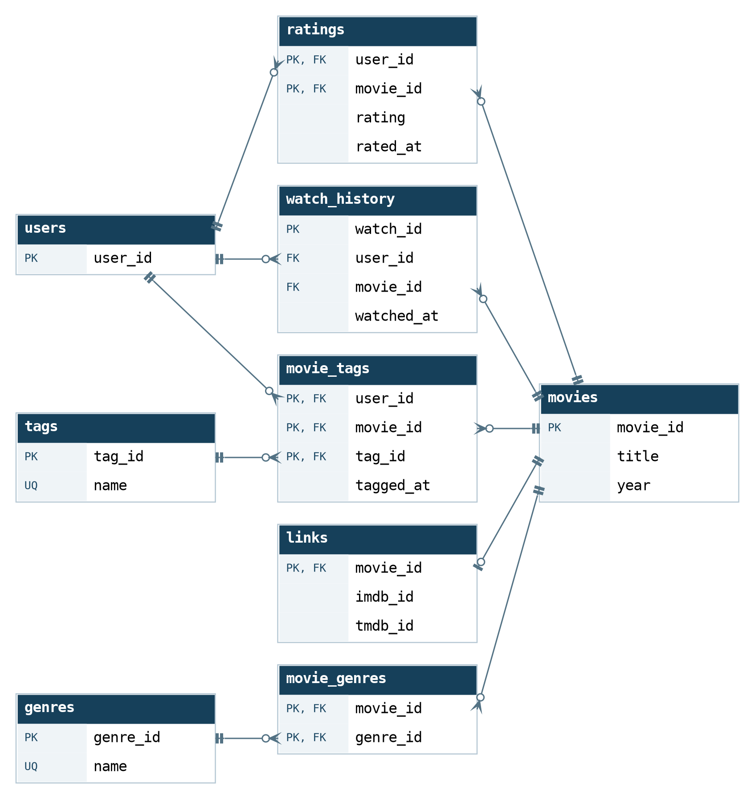

# 5 数据库设计

MovieRec 使用 PostgreSQL 18 存储电影、类型、用户、评分、标签和观看记录。MovieLens 提供电影、评分、标签和外部链接。系统用评分和标签中出现的用户 ID 建立用户表，用独立的观看记录表保存系统生成的观看事件。

## 5.1 实体与关系



图 5.1　MovieRec ER 图。PK 为主键，FK 为外键，UQ 为唯一约束。同一表内标注多个 PK 的列共同组成联合主键。

- 一部电影可以属于多个类型，一个类型也可以包含多部电影，`movie_genres` 保存每个电影与类型的组合。
- `ratings` 使用 `(user_id, movie_id)` 作主键，保存每位用户对每部电影的当前评分。用户重新评分时更新该行。`watch_history` 用独立的 `watch_id` 标识每次观看，允许同一用户多次观看同一部电影。
- `tags` 保存规范化后的标签名称，`movie_tags` 保存用户为电影添加的标签。同一个用户给同一部电影添加同一个标签时，导入保留最早的时间。每部电影最多有一行 `links`，用于存储外部平台 ID。

## 5.2 关系模式与约束

| 关系及属性 | 候选键（首个为主键） | 外键 |
|---|---|---|
| `users(user_id)` | `user_id` | — |
| `movies(movie_id, title, year)` | `movie_id` | — |
| `genres(genre_id, name)` | `genre_id`、`name` | — |
| `movie_genres(movie_id, genre_id)` | `(movie_id, genre_id)` | `movie_id → movies`、`genre_id → genres` |
| `ratings(user_id, movie_id, rating, rated_at)` | `(user_id, movie_id)` | `user_id → users`、`movie_id → movies` |
| `tags(tag_id, name)` | `tag_id`、`name` | — |
| `movie_tags(user_id, movie_id, tag_id, tagged_at)` | `(user_id, movie_id, tag_id)` | `user_id → users`、`movie_id → movies`、`tag_id → tags` |
| `links(movie_id, imdb_id, tmdb_id)` | `movie_id` | `movie_id → movies` |
| `watch_history(watch_id, user_id, movie_id, watched_at)` | `watch_id` | `user_id → users`、`movie_id → movies` |

导入时，类型字段按 `|` 分解，`(no genres listed)` 对应零条电影类型关联。片名末尾符合格式的四位年份存为 `year`，缺失时允许为 `NULL`。评分和标签的 Unix 秒时间戳转换为 UTC，再存入 `TIMESTAMP`。`imdb_id` 使用字符型保留前导零，缺失的 `tmdb_id` 存为 `NULL`。标签去除首尾空格并转为小写，空标签在导入时过滤。MovieLens 导入完成后，`watch_history` 为空。

`ratings.rating` 使用 `NUMERIC NOT NULL` 保存输入精度。`CHECK` 同时要求分数在 0.5 至 5.0 之间且为 0.5 的整数倍。例如 4.5 可以写入，4.54 会被拒绝。主键和外键约束防止重复评分与孤立记录。

## 5.3 函数依赖与范式

| 关系 | 由业务规则和约束确定的非平凡函数依赖 |
|---|---|
| `users` | 无，仅包含主键 |
| `movies` | `movie_id → title, year` |
| `genres` | `genre_id → name`，`name → genre_id` |
| `movie_genres` | 无，两个属性共同组成候选键 |
| `ratings` | `(user_id, movie_id) → rating, rated_at` |
| `tags` | `tag_id → name`，`name → tag_id` |
| `movie_tags` | `(user_id, movie_id, tag_id) → tagged_at` |
| `links` | `movie_id → imdb_id, tmdb_id` |
| `watch_history` | `watch_id → user_id, movie_id, watched_at` |

正式表将类型列表拆成关联行，各字段按当前业务作为单值处理，满足第一范式。以 `ratings` 为例，单凭用户或电影都无法决定评分值和评分时间，非键属性依赖完整的联合键。电影标题、类型名称和标签名称各存在所属实体表中，关联表通过外键引用它们。在上述业务函数依赖下，每个非平凡依赖的决定因素都是超键，因此各关系满足 BCNF，也满足 3NF。电影标题与年份、IMDb ID 与 TMDb ID 均未在当前模式中定义为候选键。

## 5.4 索引策略

正式表脚本创建主键和唯一约束对应的索引。例如，`ratings` 上的 `(user_id, movie_id)` B-tree 支持按用户定位评分并保证评分组合唯一，评分历史还会按时间排序。应用库在建表和批量导入完成后执行 `sql/recommended_indexes.sql`，创建片名 trigram GIN、`ratings(movie_id, rating)` 和 `movie_genres(genre_id)`。实验库按各配置加载二级索引。

| 查询 | 实验中的索引 | 验证目标 |
|---|---|---|
| 片名包含搜索 | `pg_trgm` GIN，`movies(title gin_trgm_ops)` | 检查能否加速 `ILIKE '%关键词%'`。 |
| 按类型浏览和单类型 Top-N | B-tree，`movie_genres(genre_id)` | 检查按类型筛选时的扫描方式与行数估计。前端传 `genre_id`，查询直接按 ID 过滤。 |
| 单片评分聚合和 Top-N 评分连接 | B-tree，`ratings(movie_id)` 和独立配置的 `(movie_id, rating)` | 比较按电影定位评分，以及执行评分聚合时能否使用索引覆盖所需列。 |
| 评分时间范围 | B-tree 与 BRIN，`ratings(rated_at)` | 对比时间范围扫描。BRIN 单独测试原始顺序和按时间重排后的数据。 |

在 25M 数据上，`recommended` 配置的执行计划显示，片名搜索使用 trigram 索引，单片评分分布使用复合索引做 Index Only Scan，按类型浏览和单类型榜单使用 `movie_genres(genre_id)` 查找类型关联。相对基线，片名搜索的中位耗时从 20.324 ms 降至 0.341 ms，单片评分分布从 3266.556 ms 降至 13.112 ms。单类型榜单仍需聚合大量评分，第 6 节报告完整性能实验。

在 `btree` 配置下，以类型名连接的单类型榜单中位耗时约 85.07 秒，按类型 ID 筛选的版本约 1.79 秒。前者的执行计划低估了 Comedy 关联的行数，并对评分索引执行了 16,870 次查找。这个差距与索引配置和执行计划有关，应用统一采用类型 ID 作为筛选参数。

## 5.5 核心查询与结果

在装载 `ml-latest-small` 后，先在 `psql` 会话中执行 `\i sql/queries.sql`，然后运行下列示例。应用先请求类型列表获取当前库的 ID。以下样例库中 Comedy 的 `genre_id` 为 5。

| 执行语句 | 实测结果 |
|---|---|
| `EXECUTE search_movies_by_title('star wars', 20, 0);` | 返回 13 部电影，包括 *Rogue One: A Star Wars Story*。 |
| `EXECUTE list_movies_by_genre(5, 20, 0);` | 返回 Comedy 类型的首批 20 部电影。 |
| `EXECUTE list_user_ratings(1, 3, 0);` | 返回用户 1 最近的 3 条当前评分，首条为 *20 Dates*，4.0 分。 |
| `EXECUTE top_movies_in_genre(5, 50, 3);` | 返回 Comedy 中至少有 50 条评分的前 3 部电影，榜首为 *Dr. Strangelove or: How I Learned to Stop Worrying and Love the Bomb*，均分约 4.268，97 条评分。 |
| `EXECUTE top_movies_by_genre(50, 20);` | 各类型最多返回 20 部达到评分数门槛的电影，共 337 行。 |

两个 Top-N 查询都按均分降序、评分数降序、电影 ID 升序排序。各类型 Top-N 先聚合每部电影的评分，再按类型使用 `row_number()` 排名。同一部多类型电影可以出现在多个榜单中。

## 5.6 事务与并发验证

在 PostgreSQL 18 的开发测试库中，使用两个独立连接对同一测试用户及电影执行 `INSERT ... ON CONFLICT ... DO UPDATE`。测试分两步。先让会话 A 写入 3.5 分并保持事务打开，会话 B 查询该组合得到零行。A 回滚后，B 再查仍为零行。随后让 A 重新写入 3.5 分，B 同时写入 4.5 分。B 等待 A 结束事务，A 提交后 B 完成更新。B 提交后查询得到一行，分数为 4.5。

复现时可用已导入的 `movie_id = 1`，先建立临时测试用户，再在 A、B 各自的 `BEGIN` 内执行下面的语句。第二个会话将值 `3.5` 改成 `4.5`。验证结束后，先删除测试评分，再删除测试用户。

```sql
INSERT INTO users (user_id) VALUES (9000001);
```

```sql
INSERT INTO ratings (user_id, movie_id, rating)
VALUES (9000001, 1, 3.5)
ON CONFLICT (user_id, movie_id) DO UPDATE
SET rating = EXCLUDED.rating, rated_at = EXCLUDED.rated_at;
```

```sql
SELECT count(*) AS row_count, min(rating) AS final_rating
FROM ratings
WHERE user_id = 9000001 AND movie_id = 1;
```
